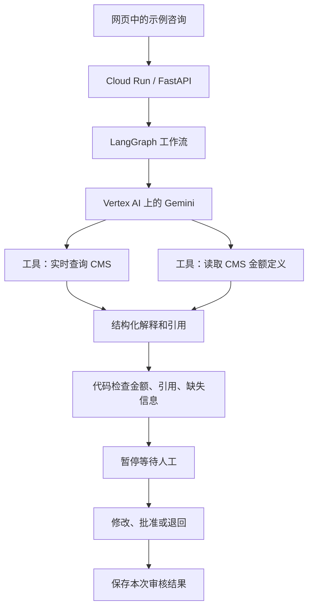

# 项目高层说明：Revenue Cycle Agent

这是一个“费用咨询处理工作台”：把一条问题变成有数据依据、经过人工审核的回复。
[打开在线 Demo](https://revenue-cycle-agent-1038659864130.us-central1.run.app)

主流程实时调用 **Vertex AI 模型 + CMS 官方 API**，不是预录结果或编造的账单。

## 用户怎样体验

1. 选择一条示例咨询，例如“医院申报收费和医保支付额为什么不同？”
2. 点击 Run agent。模型读取问题，自己调用 CMS 查询工具及金额定义工具。
3. 打开工具记录，检查查询参数、真实返回结果、数据年份和官方来源链接。
4. 查看 agent 的分类、回复草稿，以及程序给出的审核队列。
5. 人工修改草稿，再批准或退回；工作流恢复，记录结果，可以下载 JSON。

## 整体架构

**Agent 的职责**是理解问题、选择工具和解释结果。**程序规则的职责**是检查引用、
核对美元金额、要求专员处理不确定事项。**工作流引擎的职责**是控制状态转换，
在人工审核处暂停，收到决定后恢复。这些职责不全交给模型判断。

例如，“我个人最后要付多少钱？”不能通过两个平均值相减来回答。Agent 应说明
数据局限，列出实际服务明细、保险权益等所缺材料，再进入专员审核队列。

## 真实数据到底是什么

CMS 是美国医疗保险和医疗补助服务中心。这里接入它发布的 2024 年 Medicare
门诊医院／服务汇总数据，示例医院是 Mayo Clinic Hospital Rochester。

真实字段包括平均申报收费、平均 Medicare 核准金额、平均 Medicare 支付金额。
它们来自官方公开汇总记录，**不是某个患者的账单，也不是当前报价或个人应付额**。
咨询问题是我们编写的测试场景；数据记录来自实际 API。数据为空时显示“不可用”，不当成零。

## UiPath 在哪里

现在有两种入口：

- **网页 Demo**：在网页完成查询和审核，便于面试时展示。
- **UiPath 云端任务**：`uipath_cost_review` 调用同一个 Google Cloud agent，
  把查询证据和草稿保存在 UiPath 工作流状态里，创建 Action Center Quick Form，
  暂停等待审核；审核完成后自动恢复并记录结果。

这使 agent 负责理解和查询，UiPath 负责跨系统接力及人工任务。Google 认证由 Cloud Run
服务账号提供，不把 Google 密钥放进 UiPath。公开网页也不保存 UiPath 凭据。

## 什么已经验证

- 26 项本地单元／集成检查通过。
- 6 个真实 CMS + Vertex 场景的流程检查通过，记录在 artifacts/eval-cms-live.json。
- Cloud Run 线上查询及审核恢复通过；浏览器可以查看真实工具返回值。
- UiPath 云端任务创建 Quick Form、暂停、收到测试审核决定后恢复为 Successful。
  这一项通过 API 提交测试决定，验证恢复机制，不冒充真人审核。
- 自动检查覆盖来源 ID、金额和流程状态，不等于证明每句话都正确。

## 借鉴与自己的改动

Google 官方项目提供服务和模型接入框架，UiPath 官方例子提供图和暂停／恢复方式。
本项目新增了 CMS 数据工具、金额解释和检查、专员分流、工作流可视化、可编辑审核及案例验证。
源码出处、固定版本和许可证保留在 PROVENANCE.md。

网页体验的状态保存在单个服务实例内存中；重启后会清空。UiPath 云端流程会保存其证据快照及审核状态。尚未接入医院 EHR、患者账户、
索赔系统或付款系统，不会发送真实消息或执行财务操作。
