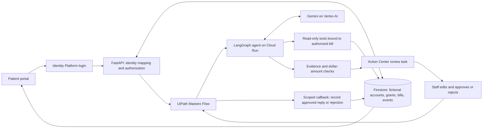

# Patient Inbox Agent — Revenue Cycle Demo

**A patient asks about a bill; an AI agent checks authorized records; a staff reviewer decides what is sent back.**

[Open the live demo](https://revenue-cycle-agent-1038659864130.us-central1.run.app) · [中文说明与三分钟演示](PROJECT_BRIEF_ZH.md) · [Deployment](DEPLOYMENT_PLAN.md) · [Attribution](PROVENANCE.md)

An independent learning prototype for patient-portal billing messages. The cloud identity service, database, Vertex AI calls and UiPath Maestro workflow are live. **Patients, individual bills, insurance events and portal questions are fictional.** This project has no affiliation with Mayo Clinic and no connection to a hospital EHR or patient messaging system.

## Try it

1. Choose **Anna** on the login screen. The public demo account signs in through Google Cloud Identity Platform.
2. Select a bill and send the prefilled question: insurance paid but a balance remains, or a statement arrived after payment.
3. Switch to **Financial reviewer**. Inspect the agent's two tool calls, evidence and draft. Edit the draft, then approve or reject.
4. Switch back to Anna. Only an approved reply appears. A rejection sends no draft.
5. Try the other-patient access button: Anna cannot access Ben's bill. Anna can access an explicitly authorized child's bill.

All three accounts have public demo passwords shown on screen. They separate roles for demonstration; they are not private accounts or proof of a real person's identity. Never enter real patient data. Staff clicks actually complete Action Center tasks through the backend API.

## Architecture



- **Maestro** runs the outer business process: request a draft, create a native Quick Form, wait, branch on approval/rejection and call the portal back. Its deployable source is [`RevenueCycle/PatientInbox/.flow-sdk/PatientInbox.flow.ts`](RevenueCycle/PatientInbox/.flow-sdk/PatientInbox.flow.ts).
- **LangGraph** runs the inner agent and evidence checks. The model calls `lookup_authorized_bill` and `lookup_insurance_payment_events`; neither accepts an arbitrary patient ID or SQL query. Both recheck authorization.
- **Vertex AI** supplies model inference using the Cloud Run service account, not a browser API key.
- **Identity Platform** verifies login. The backend maps verified issuer/subject to an account and checks active patient/proxy grants. Login and authorization are separate checks.
- **Firestore** persists sessions, inquiries, synthetic billing records, grants and audit events. It is not an SSO service.
- **Action Center** holds the review task. The reviewer UI calls its API; only Maestro's scoped completion callback releases a reply.

LangGraph can also orchestrate durable human-in-the-loop work. This division demonstrates how an enterprise workflow platform can surround a custom agent; it is not a claim that one framework cannot perform the other's orchestration tasks. No desktop RPA bot runs in this project.

## Real CMS data is separate

[/cms](https://revenue-cycle-agent-1038659864130.us-central1.run.app/cms) retains the earlier live CMS cost-reference workbench. It reads 2024 hospital/service aggregates from the [official CMS dataset](https://data.cms.gov/provider-summary-by-type-of-service/medicare-outpatient-hospitals/medicare-outpatient-hospitals-by-provider-and-service). Historical averages cannot identify a patient, prove ownership of a bill, or calculate personal responsibility. The patient portal never substitutes CMS averages for its fictional bill records. [Earlier workbench details](docs/cms-workbench.md).

## Verification and limits

Run `uv run pytest tests/unit tests/integration -q`. The current suite has **35 passing checks**, including identity mapping, cross-patient denial, proxy revocation between tool calls, role/CSRF boundaries, scoped callbacks, idempotency, modern-folder task matching and withholding replies until the Maestro callback.

Cloud runtime verification is recorded in `docs/verification-2026-11-13.md`. Test decisions made through automation are labeled as verification, not independent human review. Numeric and citation checks are bounded checks; they do not prove every statement is correct or establish clinical validity.

This is a prototype: public shared accounts, four synthetic bills, a single reviewer, bounded daily inquiry counts, 30-minute sessions and 24-hour workflow callback credentials. It has no real patient identity enrollment, hospital SSO federation, EHR integration, claims submission, email, refunds or payments. Rejected cases remain for manual follow-up. Production would additionally need recovery/reconciliation, operational monitoring, load testing, real staff access management and hospital-approved data governance.

## Run locally

Use Python 3.11–3.13 and `uv sync --frozen`. Cloud configuration and provisioning requirements are in [Deployment](DEPLOYMENT_PLAN.md). For the standalone public CMS workbench, configure Vertex AI ADC and run:

```bash
BILLING_MODE=vertex uv run uvicorn app.fast_api_app:app --host 127.0.0.1 --port 8767
```

Open `http://localhost:8767/cms`. The new portal additionally needs an identity provider, seeded database and deployed Maestro process; it intentionally does not silently pretend these services are connected.

## Source map and attribution

| Path | Responsibility |
|---|---|
| `app/portal/auth.py`, `service.py` | Verified login, session, roles and bill/proxy authorization |
| `app/portal/store.py`, `fixtures.py` | Firestore/SQLite persistence and explicitly fictional seed records |
| `app/portal/agent.py` | LangGraph, Vertex AI tools, structured draft and evidence checks |
| `app/portal/api.py`, `uipath.py` | Intake, confidential OAuth, Maestro job, Action Center review and callbacks |
| `RevenueCycle/` | Official SDK-authored Maestro Flow and generated solution artifacts |
| `app/static/portal.html`, `assets/portal.*` | Patient and reviewer experience with tool labels |
| `app/cms.py`, `cost_workflow.py`, `uipath_cloud.py` | Separate earlier CMS demo and legacy coded-agent entry point |

Adapted from [Google agents-cli](https://github.com/google/agents-cli) (Apache-2.0) and [UiPath LangGraph examples](https://github.com/UiPath/uipath-langchain-python) (MIT). The new portal and Maestro integration extend that scaffold; upstream code is not claimed as original work. See [PROVENANCE.md](PROVENANCE.md), [LICENSE](LICENSE), and [THIRD_PARTY_NOTICES.txt](THIRD_PARTY_NOTICES.txt).
