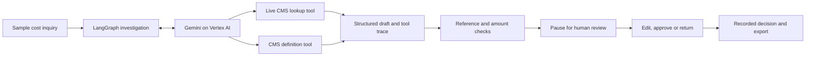

# Revenue Cycle Agent

**A cost inquiry workbench with live CMS data, real model tool calls, and human review.**

An agent reads a public cost question, queries CMS hospital/service records,
explains the evidence and pauses for a reviewer. The reviewer can edit, approve
or return the draft, then download the resulting review record.

[中文项目说明](PROJECT_BRIEF_ZH.md) · [Data and code provenance](PROVENANCE.md) · [Deployment](DEPLOYMENT_PLAN.md)

## See the workflow



The model chooses tool calls and interprets their results. Ordinary code enforces
reference checks, matching of quoted dollar amounts, specialist routing and the
review gate. Tool inputs/outputs are visible; no private model reasoning is exposed.

## Real data, with a precise scope

The main demo calls the [official CMS API](https://data.cms.gov/provider-summary-by-type-of-service/medicare-outpatient-hospitals/medicare-outpatient-hospitals-by-provider-and-service/api-docs).
It uses **2024 Medicare outpatient hospital/service aggregates**, pinned to dataset
`771e94a2-cd8f-4702-a9d7-8f777f363938`. The sample provider is Mayo Clinic Hospital
Rochester, CCN `240010`. This is an independent project with no hospital affiliation.

These are real historical averages of submitted charges, Medicare allowed amounts
and Medicare payments. They are **not personal patient bills, current price quotes,
commercial negotiated rates or an individual's insurance benefits**. The questions
are authored examples. Blank amounts remain unavailable, never zero.

The demo includes six cases: explain amounts, look up a benchmark, request a
personal estimate, question a charge, handle missing amounts, and handle a missing
service. Every run makes real model/tool requests; failures are shown explicitly.
There is no recorded-response fallback in the main workbench.

## Run

Use Python 3.11–3.13 and [uv](https://docs.astral.sh/uv/). Configure an authorized
Google Cloud project with Vertex AI enabled, billing and Application Default
Credentials. Copy `.env.example` to `.env` only if the file does not exist, and
set `GOOGLE_CLOUD_PROJECT` to your project ID.

```bash
uv sync --frozen
BILLING_MODE=vertex uv run uvicorn app.fast_api_app:app --host 127.0.0.1 --port 8767
```

Open http://localhost:8767. An optional local-only `BILLING_USE_GCLOUD_AUTH=true`
uses your existing gcloud login, keeping the short-lived token in memory. Restart
that local process after 45 minutes. Deployed containers use their runtime service
account; do not enable the local gcloud option there. Model calls incur charges.

## Verification

```bash
BILLING_MODE=replay uv run pytest tests/unit tests/integration -q
BILLING_MODE=vertex uv run python scripts/evaluate_cms.py
```

23 local unit/integration checks passed, including missing data, unsupported
amounts, incorrect API filters, editable human review, and bounded public API input.
Six live CMS + Vertex cases passed their smoke checks; full results are in
[`artifacts/eval-cms-live.json`](artifacts/eval-cms-live.json).
These checks do not establish production accuracy or full semantic faithfulness.

## UiPath

`langgraph.json` exports `cost_workflow` for the UiPath Python/LangGraph SDK.

```bash
BILLING_MODE=vertex uv run uipath init --no-agents-md-override
BILLING_MODE=vertex uv run uipath run cost_workflow --file examples/cms-inquiry.json
uv run uipath pack
```

The earlier synthetic workflow's local SDK suspend/resume and packaging were
verified. The new cost graph uses the same interrupt pattern. Automation Cloud
and Action Center integration is being configured; it is not yet verified.
Set `UIPATH_REVIEW_APP` and `UIPATH_REVIEW_FOLDER` only after configuring an
appropriate Action Center app. Account creation alone does not prove orchestration.

## Layout

| File | Purpose |
|---|---|
| `app/cms.py` | Live CMS retrieval and source definitions |
| `app/cost_workflow.py` | Model/tools, checks, routing and human pause/resume |
| `app/cost_api.py` | Six bounded sample cases and review API |
| `app/static/` | Workbench UI with tool traces and editable review |
| `scripts/evaluate_cms.py` | Live end-to-end smoke cases |
| `app/agent.py`, `app/billing.py`, `app/workflow.py` | Earlier synthetic billing prototype and inherited agent contract |

`PUBLIC_DEMO=true` limits model requests to the six published cases and disables
the legacy free-text and A2A surfaces. Requests have a per-process rate limit,
two concurrent model calls, and a 100-session cap. Sessions and review records
are in memory: restarts lose them. This is a demonstration, not a production queue.
No email, claim, refund, coverage, referral or payment operation is performed.

The earlier synthetic prototype and upstream generic evaluation examples remain
clearly separate from the CMS workbench. Its eight-case results do not count as
evidence for the new six-case live workflow.

## Attribution

Adapted from [Google agents-cli](https://github.com/google/agents-cli) (Apache-2.0)
and [UiPath's official LangGraph examples](https://github.com/UiPath/uipath-langchain-python)
(MIT). See [PROVENANCE.md](PROVENANCE.md), [LICENSE](LICENSE) and
[THIRD_PARTY_NOTICES.txt](THIRD_PARTY_NOTICES.txt) for pins, changes and notices.
